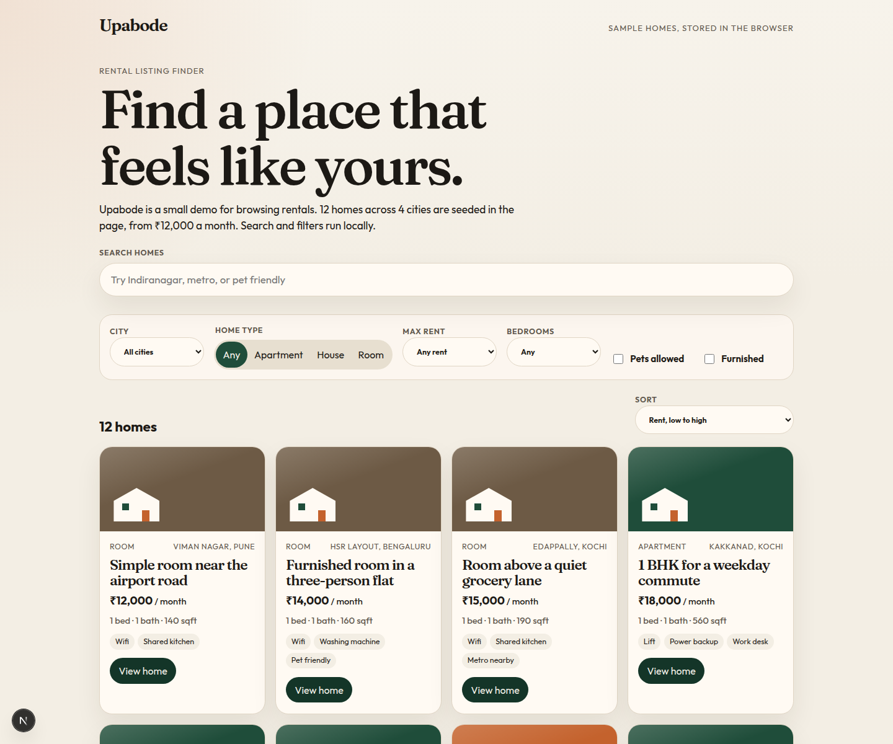
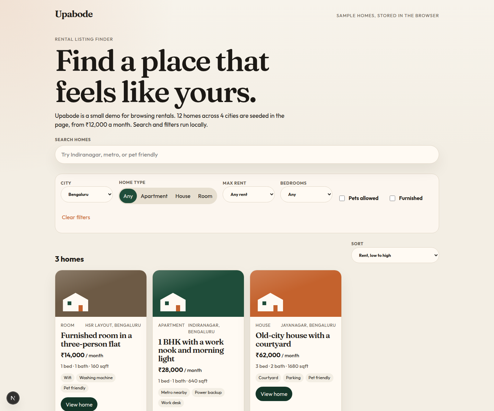
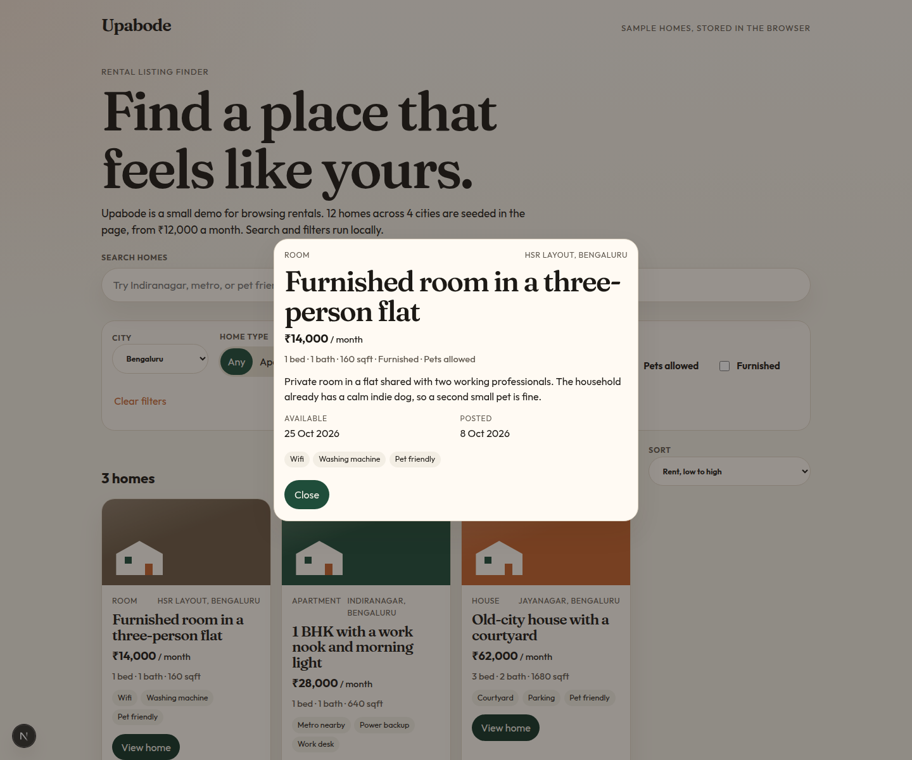

# Upabode

Upabode is a small rental listing finder. It ships with 12 sample homes across Bengaluru, Pune, Hyderabad, and Kochi. Search and filters run in the browser, so the site needs no account, database, or API key.

**Live site:** [https://naveecode.github.io/upabode/](https://naveecode.github.io/upabode/)

GitHub Pages has to be set to **GitHub Actions** before that URL serves this build. The deploy workflow in this repo publishes the static `out/` folder on every push to `main`.

## Features

- Text search across title, neighborhood, city, description, and amenities
- Filters for city, home type, maximum rent, bedrooms, pets, and furnished
- Sort by rent or by recently posted
- A listing detail dialog with availability and amenities
- Sample data is bundled with the page

## Stack

- Next.js 16 (App Router) and React 19
- TypeScript
- Static export (`output: 'export'`) with `basePath` `/upabode` for GitHub project pages
- Vitest for the search and filter functions
- GitHub Actions for lint, typecheck, unit tests, build, and Pages deploy

## Screenshots







## Run locally

```bash
npm install
npm run dev
```

Open [http://localhost:3000/upabode](http://localhost:3000/upabode). The `/upabode` prefix matches the GitHub Pages base path.

```bash
npm test
npm run lint
npm run typecheck
npm run build
```

`npm run build` writes the static site to `out/`.

## What I learned

- A static export can only include what is known at build time. Keeping the listings in the client, and the matching rules in plain functions, meant the page could be hosted as files.
- Those functions are easier to trust once the awkward cases are tests: blank queries, combined filters, every search word required, and sorts that do not reorder the original array.
- Project pages need `basePath: '/upabode'` so CSS, JavaScript, and fonts load from `/upabode/_next/...` instead of the domain root.
- This repository already contained a larger social app (Multigram) that depends on a database, cookies, and route handlers. That cannot be a static export, so the source is preserved under [`legacy/multigram`](legacy/multigram) rather than deleted. Credentials that had been committed in its Render config were replaced with placeholders; the old values are still in git history and should be rotated.
